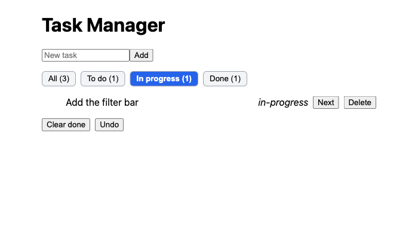
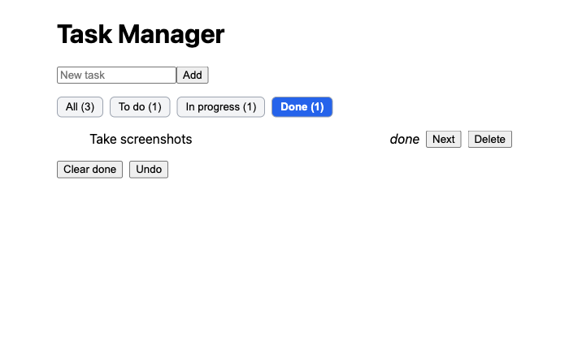

# Assignment 3: Task Manager with a Reducer

**Batıkan Karakan, 1700002010**

A Vite + React + TypeScript Task Manager. All state lives in `App` with `useReducer` and goes down as props.
The state is `{ tasks, filter, past }`; the filtered list and the counts are derived while rendering.

```
npm install
npm run dev       # open the address it prints
npm run build     # type check (strict) and build
npm test          # run the Vitest tests
```

Needs Node.js 20.19 or newer.

## Files

- `src/taskReducer.ts`: `State`, `Action`, `initialState`, `taskReducer` (R1 to R3, Bonus 1).
- `src/filter.ts`: `Filter`, `filterTasks`, `countByFilter`; no React (R4).
- `src/App.tsx`: `useReducer`; `AddForm`, `FilterBar`, `TaskList`, Clear done and Undo buttons (R5, R6).
- `src/TaskRow.tsx`: one row with title, status, Next and Delete.
- `src/*.test.ts`: Vitest tests (Bonus 2).
- `screenshots/`: `all.png`, `todo.png`, `in-progress.png`, `done.png`.

## Screenshots

| All | To do | In progress | Done |
| --- | --- | --- | --- |
|  |  |  |  |

## Bonuses claimed

Bonus 1, Bonus 2, Bonus 3 and Bonus 4.

## Bonus 1: Undo

The state is `{ tasks: Task[]; filter: Filter; past: Task[][] }`. `past` is a stack of earlier task lists,
newest last. Every action that changes the tasks (`add`, `advance`, `remove`, `clearDone`) goes through one
helper, `withTasks`, which pushes the old list onto `past`; `{ type: 'undo' }` pops the last list back into
`tasks`.

- The filter is not part of the history, so `setFilter` is not undoable and undo keeps the current filter.
- Undo after `clearDone` brings the cleared tasks back.
- An action that changes nothing (an unknown id, or `clearDone` with no done tasks) returns the same state
  and is not recorded, so Undo never "undoes" nothing.
- Undo with an empty `past` returns the same state, and the Undo button is disabled when `past` is empty.

## Bonus 2: Tests

Vitest, 27 tests in `src/taskReducer.test.ts` and `src/filter.test.ts`. They cover every action, advancing
three times back to `todo`, purity (the input state is deep-frozen with `Object.freeze`, so a mutation would
throw, and it is compared with a `structuredClone` copy after a chain of actions), `filterTasks`,
`countByFilter`, undo, and edge cases: unknown ids, empty lists, `clearDone` with nothing done, counts after a
delete, and no-op actions not being recorded in the history.

Output of `npm test`:

```
 RUN  v5.1.0 assignment3

 ✓ src/filter.test.ts > filterTasks > returns every task for 'all'
 ✓ src/filter.test.ts > filterTasks > returns only the tasks with that status
 ✓ src/filter.test.ts > filterTasks > returns an empty list when nothing matches
 ✓ src/filter.test.ts > filterTasks > does not change the input array
 ✓ src/filter.test.ts > countByFilter > counts every filter
 ✓ src/filter.test.ts > countByFilter > returns zeros for an empty list
 ✓ src/filter.test.ts > countByFilter > updates after a delete and an advance
 ✓ src/filter.test.ts > countByFilter > sums of the status counts equal all
 ✓ src/taskReducer.test.ts > initialState > has no tasks, filter all and no history
 ✓ src/taskReducer.test.ts > add > appends a task with status todo
 ✓ src/taskReducer.test.ts > add > works on an empty list
 ✓ src/taskReducer.test.ts > advance > moves todo -> in-progress -> done -> todo
 ✓ src/taskReducer.test.ts > advance > changes only the matching task and keeps the others as the same objects
 ✓ src/taskReducer.test.ts > advance > returns the same state for an unknown id
 ✓ src/taskReducer.test.ts > remove > deletes that task
 ✓ src/taskReducer.test.ts > remove > returns the same state for an unknown id
 ✓ src/taskReducer.test.ts > setFilter > stores the filter and keeps the same tasks
 ✓ src/taskReducer.test.ts > clearDone > removes every done task and keeps the filter
 ✓ src/taskReducer.test.ts > clearDone > returns the same state when nothing is done
 ✓ src/taskReducer.test.ts > clearDone > works on an empty list
 ✓ src/taskReducer.test.ts > purity > never changes the old state
 ✓ src/taskReducer.test.ts > purity > returns a new state object and a new tasks array when tasks change
 ✓ src/taskReducer.test.ts > undo > does nothing when there is nothing to undo
 ✓ src/taskReducer.test.ts > undo > reverts add, advance and remove one step at a time
 ✓ src/taskReducer.test.ts > undo > brings back the tasks removed by clearDone
 ✓ src/taskReducer.test.ts > undo > does not record filter changes and keeps the current filter
 ✓ src/taskReducer.test.ts > undo > does not record no-op actions

 Test Files  2 passed (2)
      Tests  27 passed (27)
```

## Bonus 3: Explain your reducer

**Why pure.** React decides whether to re-render by comparing the old and new state by reference. If the
reducer changed the old array in place (for example with `push`) and returned it, the reference would be the
same, React would think nothing changed and the screen would not update. Mutation also breaks anything that
keeps old states, like my undo history: the "old" lists in `past` would silently change too. In Strict Mode
React calls the reducer twice in development, so a reducer with side effects would also run them twice.

**Why the caller creates the id.** `crypto.randomUUID()` returns a different value every call, so a reducer
that called it would give different results for the same state and action. That makes it impure, hard to
test (I could not write `expect(...).toEqual(...)` for an added task), and under Strict Mode's double call
the two runs would create two different ids. The event handler is the right place for side effects; the
action just carries the id.

**Why derived, not stored.** The filtered list and the counts are fully determined by `tasks` and `filter`,
so storing them creates a second copy that must be kept in sync by hand. For example, if `filteredTasks` were
stored and I forgot to update it in `advance`, a task moved to Done would stay visible under the To do filter,
and the counts would be stale after a delete. Computing them while rendering makes that bug impossible.

**Filter in the reducer.** It became easier to write `clearDone` and undo correctly: one reducer sees the
whole state, so undo can restore the tasks and deliberately keep the filter. It became a bit harder in that
every task case now has to copy the state with `{ ...state, tasks }` instead of just returning an array.

## Bonus 4: Git repository

https://github.com/batikankarakan/assignment3-task-manager

The history shows the work in steps (starter, state shape and new actions, filter functions, filter bar,
undo, tests, screenshots, README). `node_modules` and `dist` are in `.gitignore`. After `git clone`,
`npm install` and `npm run dev` the app runs.
